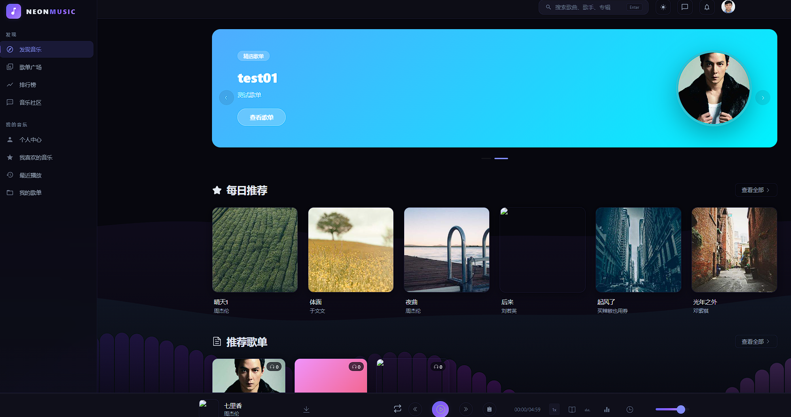
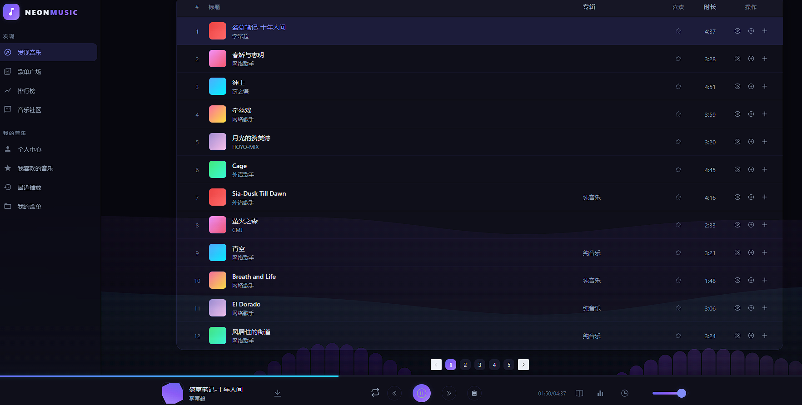
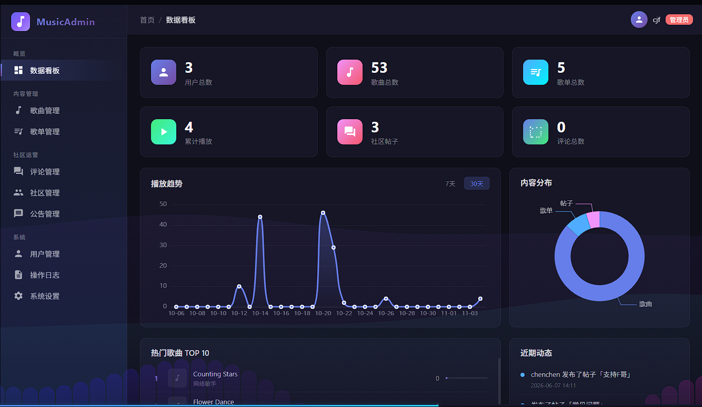

# 在线音乐社区 · Music Community

一个前后端分离的在线音乐社区：**听歌 + 歌单 + 社区互动 + 私信 + 个性化推荐 + 后台管理**。

前端 Vue 3 + Vite + Element Plus　｜　后端 Spring Boot 3 + Spring Data JPA　｜　数据 MySQL 8 + Redis

## 界面预览







---

## 功能特性

### 播放与发现
- 完整播放器：播放/暂停、上下曲、进度拖拽、音量、循环模式、迷你播放条
- Web Audio API 音频频谱可视化 + 随播放状态变化的 Canvas 动态背景
- LRC 歌词解析、逐行高亮滚动、桌面歌词
- 多维度搜索：歌曲 / 歌手 / 专辑 / 歌单 / 用户，附热搜榜与搜索历史
- 排行榜、最近播放、每日推荐、相似歌曲

### 歌单
- 歌单创建 / 编辑 / 删除，支持分类标签
- 歌单内歌曲拖拽排序（vuedraggable）
- 生成分享链接（token）对外分享歌单与单曲
- 歌单广场：按分类浏览他人歌单

### 社区
- 发布帖子，可关联歌曲 / 歌单并上传图片
- 两级评论树（评论 + 回复）、点赞、收藏
- 关注 / 粉丝、拉黑
- 私信会话（对陌生人限 2 条）、消息撤回、未读数
- 系统通知（点赞、评论、关注等）

### 个性化推荐
- **每日推荐**：六路加权混合 + ε-贪婪探索（详见下文算法说明）
- **听歌口味画像**：流派分布、常听歌手 / 专辑、口味标签

### 账号与安全
- JWT 无状态认证；图形验证码（kaptcha）防刷
- 邮箱验证码：注册、找回密码、换绑邮箱
- BCrypt 密码哈希；登录失败计数与临时锁定（Redis）
- 密码字段不参与 JSON 序列化，接口不会返回密码哈希

### 管理后台
- 数据看板：用户 / 歌曲 / 歌单统计、近 7 日播放趋势（ECharts）
- 用户、歌曲、歌单、评论、帖子、公告、歌手管理
- 操作日志：AOP 切面自动记录（操作人、模块、动作、IP）
- 系统设置与数据清理
- 权限控制：`@RequireAdmin` 注解 + 拦截器双重校验

---

## 技术栈

| 层次 | 技术选型 |
|---|---|
| 前端 | Vue 3（`<script setup>`）、Vite 5、Vue Router 4、Pinia 2、Element Plus 2、ECharts 6、Axios、vuedraggable、qrcode |
| 后端 | Java 17、Spring Boot 3.2、Spring Data JPA、Spring Mail、Spring AOP、Bean Validation |
| 认证 | JJWT 0.12、BCrypt（spring-security-crypto）、kaptcha 图形验证码 |
| 存储 | MySQL 8、Redis（验证码 / 登录锁定）、本地磁盘（可选对象存储 S3） |
| 构建 | Maven 3.9、npm / Vite |

**规模**：后端 27 个 Controller（约 150 个接口）、18 个 Service、24 个 Entity / Repository；前端 35 个页面、7 个公共组件、4 个 Pinia store。

---

## 推荐算法说明

`RecommendationService` 采用「多路召回 + 加权融合 + 探索」的结构：

| 召回路径 | 权重 | 作用 |
|---|---|---|
| ItemCF（协同过滤） | 7.0 | 找"和你口味相近的人也在听"的歌 |
| 流派（genre） | 6.0 | 偏好流派加权 |
| 歌手（singer） | 3.0 | 常听歌手加权 |
| 专辑（album） | 2.5 | 常听专辑加权 |
| 近期行为（recency） | 1.5 | 时间衰减，近期行为权重更高 |
| 全局热度（popularity） | 0.8 | 兜底，避免冷启动无结果 |

- 各路径得分归一化后加权求和，再按分数排序
- **ε-贪婪探索**：ε = 0.15，即约 15% 的推荐位随机抽取，避免推荐结果固化、给长尾歌曲曝光
- 冷启动（用户无行为数据）时退化为热度 + 随机

---

## 快速开始

### 0. 环境要求

- JDK 17+
- Node.js 18+
- MySQL 8.0
- Redis 6+

### 1. 准备数据库

```bash
mysql -uroot -p -e "CREATE DATABASE music_db CHARACTER SET utf8mb4 COLLATE utf8mb4_unicode_ci;"
mysql -uroot -p music_db < music_db_export.sql
```

> `music_db_export.sql` 是**已脱敏**的演示数据：邮箱统一为 `<用户名>@example.com`，密码哈希为演示值。

### 2. 配置环境变量

```bash
# Windows
Copy-Item .env.example .env

# Linux / macOS
cp .env.example .env
```

然后编辑 `.env` 填入真实值（数据库密码、邮箱授权码、JWT 密钥等）。**`.env` 已被 `.gitignore` 排除，不会进版本库。**

生成一个 JWT 密钥：

```bash
# Linux / macOS
openssl rand -base64 48

# Windows PowerShell
$b = New-Object byte[] 48; [Security.Cryptography.RandomNumberGenerator]::Create().GetBytes($b); [Convert]::ToBase64String($b)
```

### 3. 启动后端

```powershell
# Windows：脚本会读取 .env 注入环境变量后再启动
.\run-local.ps1
```

```bash
# 其他平台：先导出环境变量
set -a && source .env && set +a
cd backend && mvn spring-boot:run
```

> Spring Boot **不会**自动读取 `.env` 文件，必须通过环境变量注入 —— `run-local.ps1` 做的就是这件事。
> 用 IDE 启动时，请在 Run Configuration 里配置同样的环境变量（或安装 EnvFile 插件）。

后端启动在 `http://localhost:8080`。

### 4. 启动前端

```bash
cd frontend
npm install
npm run dev
```

前端启动在 `http://localhost:5173`，开发服务器已配置代理把 `/api` 与 `/uploads` 转发到 8080。

### 5. 演示账号

| 用户名 | 密码 | 角色 |
|---|---|---|
| `cjf` | `Demo@123456` | 管理员 |
| `cjf1` / `cjf2` / `cjf5` | `Demo@123456` | 普通用户 |

> 演示数据中的音频地址为外部示例链接（soundhelix），仅用于功能演示；自己上传的音频会保存在 `uploads/` 目录。

---

## 项目结构

```
music/
├── backend/                       Spring Boot 后端
│   ├── src/main/java/com/music/
│   │   ├── controller/            27 个 REST 控制器
│   │   ├── service/               业务逻辑（推荐、认证、评论、社区、私信…）
│   │   ├── repository/            JPA 数据访问
│   │   ├── entity/                24 个实体
│   │   ├── dto/                   请求/响应对象
│   │   ├── interceptor/           JWT 与管理员权限拦截器
│   │   ├── aspect/                操作日志切面
│   │   ├── storage/               本地 / S3 / 混合存储抽象
│   │   ├── config/                Web、CORS、静态资源、验证码配置
│   │   └── util/                  JWT 工具（含启动自检）
│   └── src/main/resources/
│       ├── application.yml        配置（只含 ${ENV} 引用，无任何凭证）
│       └── sql/                   初始化与维护脚本
├── frontend/                      Vue 3 前端
│   └── src/
│       ├── views/                 35 个页面（含 9 个后台页面）
│       ├── components/            播放器、导航、歌词、分享等公共组件
│       ├── stores/                Pinia 状态（播放、歌单、用户、主题）
│       └── api/                   13 个接口模块
├── music_db_export.sql            脱敏演示数据
├── ADMIN_README.md                管理后台说明
├── MUSIC_PROJECT_LEARNING_GUIDE.md 前后端功能代码级拆解
├── .env.example                   环境变量模板
└── run-local.ps1                  本地启动脚本（读取 .env）
```

---

## 配置项

所有敏感配置均通过环境变量注入（见 `.env.example`）：

| 变量 | 说明 | 必填 |
|---|---|---|
| `DB_URL` / `DB_USERNAME` / `DB_PASSWORD` | MySQL 连接 | 密码必填 |
| `REDIS_HOST` / `REDIS_PORT` | Redis 连接 | 否，默认 localhost:6379 |
| `MAIL_HOST` / `MAIL_USERNAME` / `MAIL_PASSWORD` | SMTP 发信（QQ 邮箱授权码） | 功能相关 |
| `UPLOAD_DIR` | 上传目录，服务器上建议用绝对路径 | 否，默认 `./uploads` |
| `JWT_SECRET` | JWT 签名密钥，**必填**，至少 32 字节 | 是 |
| `S3_*` | 可选对象存储，全部留空则只用本地磁盘 | 否 |

> 密钥缺失时后端会**直接启动失败**并给出提示，不会用可猜的默认值运行。

---

## 部署（Linux 服务器）

```ini
# /etc/systemd/system/music.service
[Unit]
Description=Music Backend
After=network.target mysql.service redis.service

[Service]
EnvironmentFile=/etc/music/env
ExecStart=/usr/bin/java -jar /opt/music/app.jar
Restart=on-failure

[Install]
WantedBy=multi-user.target
```

```bash
sudo mkdir -p /etc/music /opt/music/uploads
sudo chmod 600 /etc/music/env      # 密钥文件仅 root 可读
sudo systemctl daemon-reload && sudo systemctl enable --now music
```

构建产物：

```bash
cd backend && mvn -DskipTests package     # target/music-backend-1.0.0.jar
cd frontend && npm run build              # dist/ 静态文件，交给 Nginx
```

Nginx 需把 `/api` 与 `/uploads` 反向代理到后端端口，其余路径回退到 `index.html`（前端使用 History 路由）。

---

## 说明与已知限制

- 演示音频为外部示例链接，非真实曲库
- 管理端部分列表接口仍为内存分页，数据量增大后需改为数据库分页
- 推荐服务在用户行为数据量大时会全表加载做 ItemCF，需改为离线计算
- 上传文件保存在本地磁盘，请自行做好目录备份
- 单元测试尚未覆盖，后续补充

---

## License

本项目为个人学习与作品展示用途。
